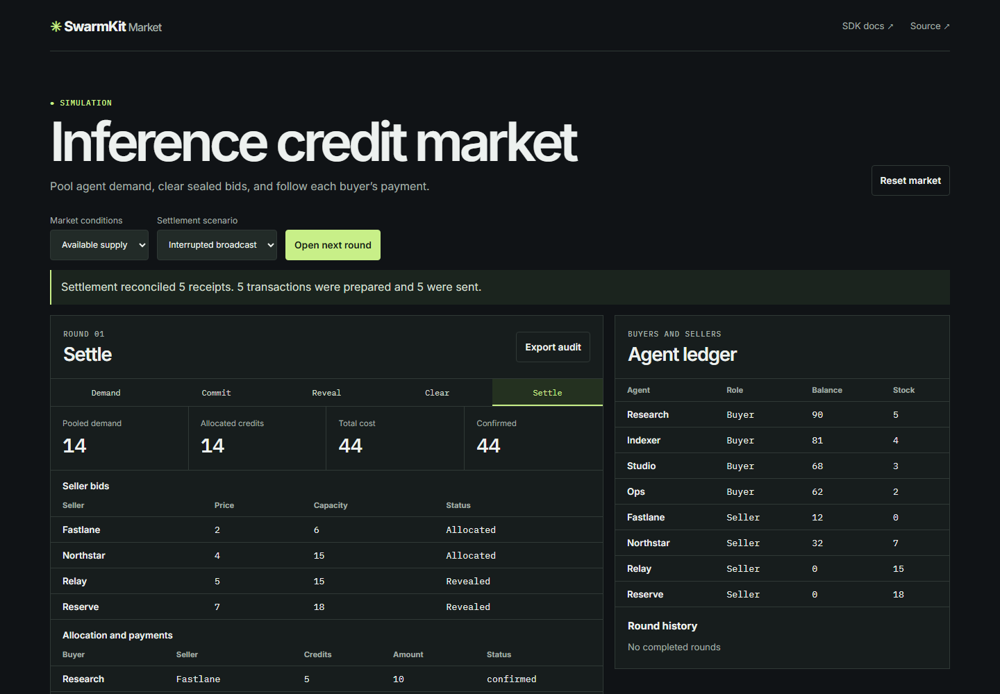

# SwarmKit Market

An inference-credit exchange built on [SwarmKit](https://github.com/mikemoulder/swarmkit). Four buyers pool demand, four sellers commit bids, and the SDK clears a split allocation. Confirmed receipts move balances and inventory into the next round.

[Open the market](https://mikemoulder.github.io/swarmkit-market/) · [SDK docs](https://mikemoulder.github.io/swarmkit-site/docs/) · [Agent guide](https://mikemoulder.github.io/swarmkit-site/agents/)



## Run locally

Use Node 22.18 or newer.

```sh
npm ci
npm test
npm run dev
```

The lockfile pins the SDK tarball in `vendor/`. It is the compiled package from the core repository. The market never imports from the core source tree. The Vite build emits a static site in `dist/`.

## Follow the money

1. Seal and reveal the offers. The allocation draws from Fastlane and Northstar.
2. Settle payments with **Interrupted broadcast** selected. Resume to reconcile the same simulated transaction hash.
3. Open the next round. Fastlane is out of inventory, so the next purchase uses different sellers.
4. Reset and choose **Buyer cap too low** to see an Ed25519 approval block that buyer’s entire allocation. Resume to supply its revised signed cap. Choose **Supply shortage** to see a round close without any payments.

The browser uses the SDK's real coordinator, replay, policy checks and settlement runner. Its transport and journal are in-memory simulation components. Export an audit JSON to inspect the transcript and receipt state. Recorded native NEAR testnet runs are presented separately and can be followed to their explorer transactions.

## Settle through NEAR Intents

The browser’s unsigned request preview uses illustrative accounts. For a funded run, supply your own closed SwarmKit transcript that uses actual accounts and a supported Verifier asset such as `nep141:wrap.near`. Configure the relayer and per-buyer caps from [accounts.example.json](accounts.example.json). Load the referenced key variables into the process environment. Buyer keys must be recognized by the Verifier and the buyers must already hold the token there. The relayer needs NEAR for gas.

```sh
npm run intents -- round.json accounts.json --review
npm run intents -- round.json accounts.json --execute
npm run intents -- round.json accounts.json --reconcile
```

Review prints the exact plan without signing. Execute signs NEP-413 requests, preflights each transfer through the SDK adapter, and can broadcast mainnet transactions. The CLI waits for each preceding payment to finalize before sending the next. Reconcile checks existing hashes without signing or broadcasting. Keep the same relayer and `.market/intents` journal across retries. Run one operator process per relayer key.

Choose [MIT](LICENSE-MIT) or [Apache 2.0](LICENSE-APACHE).
